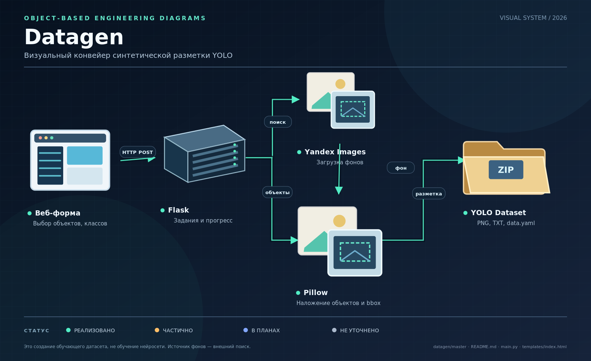
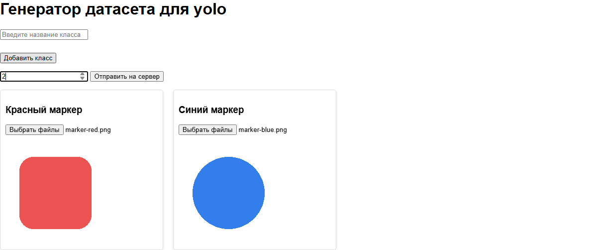
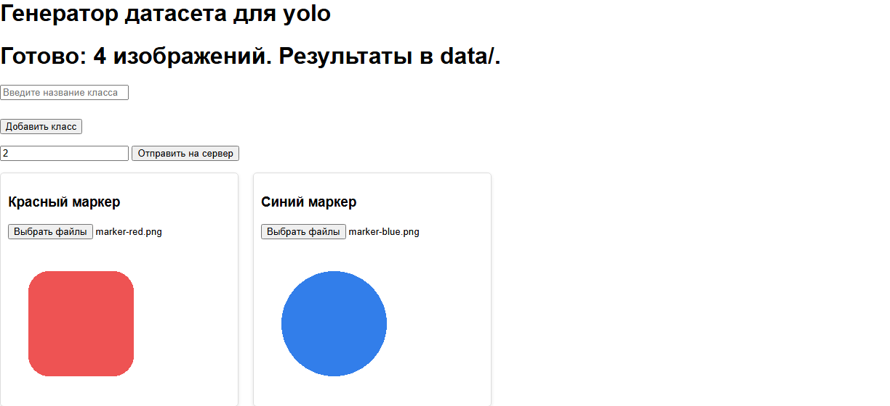

# Datagen



*Иллюстрация проекта.*

**Версия 0.1.0 · прототип**

**Синтетические изображения и YOLO-разметка из собственных объектов и найденных фонов.**

Локальное веб-приложение: добавьте классы, загрузите изображения объектов и задайте количество результатов на класс. Генератор найдёт фоновые изображения через Yandex Images, разместит на них объекты и сохранит пары PNG/TXT рядом с проектом.

> **Статус: прототип.** Локальная генерация проверена с настоящими Chrome 156, Yandex и HTTP-загрузкой фонов на Python 3.14. Поиск остаётся внешней зависимостью; обучение модели приложение не выполняет.

[Скриншоты](#скриншоты) · [Установка](#установка-и-запуск) · [Создание датасета](#как-создать-датасет) · [API](#компоненты-и-api) · [Проверка](#проверка)



*Карточки классов с предпросмотром: красный и синий маркеры, по два результата на класс.*

| Подготовить | Сгенерировать | Получить |
|---|---|---|
| Классы и собственные изображения объектов | Один объект на случайном фоне 416 × 416 | PNG + YOLO TXT + YAML с именами классов |

## Скриншоты



**Два класса × два изображения = четыре пары PNG/TXT.** На этом кадре интерфейс
получил сообщение о завершении от настоящего локального сервера. Фоны найдены
через Yandex и загружены по HTTP; ответы сервера не подменялись.

Оба скриншота сняты в Chrome 8 ноября 2026 года с работающего приложения версии
**0.1.0**. Цветные маркеры — демонстрационные PNG с прозрачностью, выбранные
через обычную загрузку файлов. Это изображения реального интерфейса.

## Возможности

- Несколько классов и несколько исходных изображений на класс.
- Ровно указанное количество изображений на каждый класс; остаток распределяется между исходниками.
- Случайные масштаб и положение одного объекта на фоне 416 × 416 пикселей.
- Поддержка прозрачности исходного изображения через Pillow.
- Нормализованная YOLO-разметка и YAML с именами классов.
- Проверка входных изображений до запуска, прогресс и сообщение об ошибке.
- Одна задача генерации одновременно в одном процессе приложения.

## Технологии

| Компонент | Назначение |
|---|---|
| Python, Flask | Локальный сервер и HTTP API |
| Pillow | Изображения, композиция и сохранение PNG |
| Selenium, Chrome, webdriver-manager | Поиск фоновых изображений |
| Requests, BeautifulSoup | Загрузка фонов и разбор HTML |
| PyYAML | Метаданные классов |
| HTML, JavaScript | Форма, предпросмотр и опрос прогресса |

## Установка и запуск

Нужны Python с поддержкой выбранных версий зависимостей, установленный Google Chrome и интернет. Офлайн-проверки доработанной версии выполнены на Python 3.14; отдельная матрица совместимости других версий не запускалась.

Из корня клонированного репозитория:

```powershell
python -m venv .venv
.venv\Scripts\python.exe -m pip install -r requirements.txt
.venv\Scripts\python.exe main.py
```

На Windows после установки окружения можно использовать `start.bat`.

Для Linux/macOS:

```sh
python3 -m venv .venv
.venv/bin/python -m pip install -r requirements.txt
.venv/bin/python main.py
```

Откройте [localhost:1488](http://localhost:1488), если страница не открылась автоматически. Сервер слушает локальный интерфейс. При первом задании webdriver-manager может скачать ChromeDriver; доступ к его серверам также необходим.

## Как создать датасет

1. Введите уникальное название класса и нажмите «Добавить класс».
2. Выберите хотя бы одно изображение для каждого класса. Для вырезанных объектов используйте PNG с прозрачным фоном; уберите лишние прозрачные поля, поскольку bbox охватывает весь вставляемый исходник.
3. Дождитесь загрузки предпросмотров и введите положительное целое количество результатов **на класс**.
4. Нажмите «Отправить на сервер» и дождитесь сообщения о готовности.

Например, 3 класса по 20 изображений дадут 60 PNG и 60 файлов разметки. Один результат содержит один объект одного класса. Масштабирование не обрезает объект за границей фона.

**Каждое принятое задание заменяет содержимое `data/images/` и `data/labels/`.** Сначала выполняются проверка входных данных и первоначальный поиск фонов. Перед новой генерацией сохраните нужные результаты отдельно. Если задание прервано после начала записи, в `data/` может остаться частичный результат; его нельзя считать завершённым датасетом.

Результат создаётся в корне репозитория, независимо от каталога запуска:

```text
data/
  images/0.png
  labels/0.txt
  data.yaml
```

Формат строки TXT:

```text
class_id center_x center_y width height
```

Координаты нормализованы относительно 416 × 416. Идентификаторы классов соответствуют порядку карточек, начиная с нуля. `data.yaml` содержит `nc` и `names`; разбиение train/val и пути для конкретного инструмента обучения нужно настроить самостоятельно. Обучение модели приложение не выполняет.

## Компоненты и API

| Файл | Назначение |
|---|---|
| `main.py` | Flask, валидация, фоновая задача, поиск и генерация |
| `templates/index.html` | Карточки классов, чтение файлов и прогресс |
| `requirements.txt` | Прямые зависимости |
| `start.bat` | Запуск локального окружения на Windows |
| `main.py~` | Существующая старая резервная копия; при запуске не используется |

`POST /upload_cards` принимает JSON вида:

```json
{"togen": 20, "data": [{"name": "object", "files": ["data:image/png;base64,..."]}]}
```

`files` должен содержать настоящие base64-изображения. Успешное принятие: HTTP 200 и `["ok"]`; неправильный ввод: HTTP 400; занятая задача: HTTP 409. Ответ 200 означает начало задания, а не завершение генерации.

`GET /getp` возвращает `pech`, `pechmax` и `error`: неотрицательный `pech` — число готовых пар; `-1` — завершение; `-2` — ошибка. При старте приложения прогресс равен `0/0`. После ошибки подробности доступны в журнале сервера.

## Проверка

Проверить зависимости и локальную страницу без запуска Chrome:

```powershell
.venv\Scripts\python.exe -m pip check
.venv\Scripts\python.exe -c "from main import app; assert app.test_client().get('/').status_code == 200; print('HTTP smoke: OK')"
```

В репозитории пока нет собственного набора автотестов. При доработке использовались 14 внешних офлайн-проверок Flask и реальных PNG/TXT/YAML с подменой браузера и HTTP-загрузки. Отдельно проверены форма с настоящим FileReader в Chrome и сквозная онлайн-генерация 1 × 1 с сохранением PNG/TXT/YAML. Для скриншотов также пройден полный браузерный сценарий: загрузка двух классов → реальная генерация двух изображений на класс → сообщение о завершении; созданы четыре PNG и четыре TXT. Нагрузочные проверки и оценка качества датасета для обучения не выполнялись.

## Ограничения и дальнейшее развитие

- Поиск зависит от HTML Yandex; CAPTCHA, изменение разметки или недоступные фоны приводят к ошибке задания. Для загрузки фона установлены таймауты и максимум 30 попыток на результат.
- Прогресс хранится в памяти одного процесса. Несколько процессов сервера, отмена и возобновление заданий не поддерживаются.
- Объекты размещаются без физического моделирования освещения; пригодность разметки и качество обучения требуют ручной оценки.
- Фоновые изображения могут иметь ограничения использования: проверяйте права перед публикацией полученного датасета.

План развития: собственные локальные фоны, воспроизводимое случайное зерно, разбиение train/val, сохранение истории заданий и автотесты в репозитории. Эти возможности пока не реализованы.
